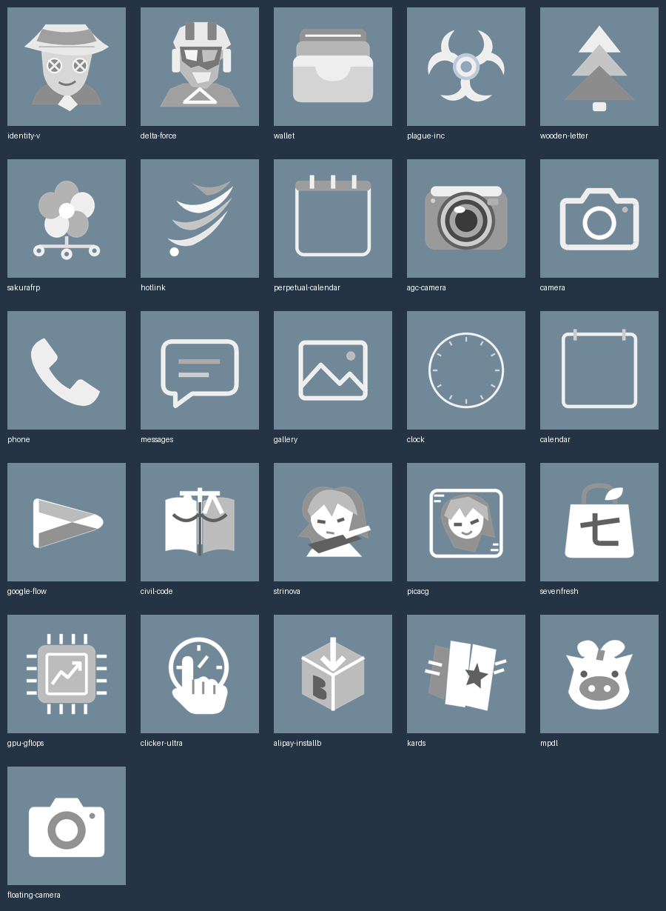

# DreamGlass Icons · 定制图标库

供 DreamGlass ColorOS 17 使用的独立、按需下载图标库。安装包不内置这些定制素材。应用在本机按包名匹配，只下载已安装应用对应的图标，不上传应用列表。

目前包含 26 份可编辑绘图、35 个包名映射：第五人格、三角洲行动、系统钱包、瘟疫公司、一个木函、SakuraFRP、Hotlink、万年历、AGC 相机，以及相机、电话、信息、相册、时钟、日历；现新增 Google Flow、民法典速查、卡拉彼丘、PicACG、七鲜、GPU GFLOPS、定时点击器Ultra、支付宝 InstallB、KARDS、Floating Camera 和 MPDL。



预览为透明图标前景，灰色底板仅用于展示。下载后的前景与 DreamGlass 的壁纸折射、透光、边缘高光材质组合，不会把预览底板固定进图标。时钟指针与日历日期由客户端按照本机时间、时区绘制；下载文件仅提供底图。

## 应用中使用

在「桌面图标」中开启图标功能，点击「扫描已安装应用」，然后点击「一键下载匹配图标」。下载完成返回桌面即可应用，之后可离线使用。两种渲染模式共用这些前景，预制图标继续为实时模式和桌面动画提供回退。

用户自行上传的图片只保存在设备本地，优先于在线库，保留上传图片的原始颜色，不自动转为浮雕。可在自定义页面恢复所选应用的默认处理。

安卓默认图标由客户端匹配系统默认资源后统一生成玻璃机器人，不给每个占位图标应用建立专门适配。复杂图片采用重新绘制的语义图案，保留主要特征；素材的深浅层次交由统一玻璃材质处理。

## 数据格式

`index.json`：`schema: 1`，`icons` 数组中每条记录包含：

```json
{
  "package": "com.tencent.tmgp.dfm",
  "label": "三角洲行动",
  "path": "icons/delta-force.png",
  "sha256": "64 位小写 SHA-256",
  "dynamic": ""
}
```

`dynamic` 可为 `clock`、`calendar` 或空字符串。素材是 256×256 透明 PNG，灰阶用于区分前景的深浅与高度。客户端仅接受相对 PNG 路径，验证散列、体积和解码尺寸，不下载或执行代码。

## 自定义 ZIP 导入

ZIP 中只放顶层图片，文件名直接使用应用包名，支持 PNG、JPG、JPEG、WebP。例如：

```text
com.netease.dwrg.png
com.tencent.tmgp.dfm.png
com.finshell.wallet.webp
```

无需清单，不放文件夹。单张原始图片最多 8 MiB，展开后原始图片总量最多 32 MiB，最多 500 个不同包名。导入会校验实际图片内容并居中裁切为正方形；任一图片不合法时，不修改现有应用配置。未安装应用的图标也可先导入，供以后匹配。

## 修改与构建

- 编辑 `src/*.svg`，在 `catalog.json` 中维护包名映射。
- 安装 `Pillow` 和 `fonttools`，执行 `python tools/build.py`。
- 脚本重新生成 `icons/*.png`、`index.json` 的散列与 `preview.png`。
- `python tools/validate.py` 检查所有公开数据及素材。

素材是根据应用语义与用户提供参考重新绘制的风格化适配。仓库不包含原始应用 APK、游戏素材包、手机日志或用户截图。应用名称和标志的商标权属于各自权利人，不代表官方授权或合作。

源码及本项目原创绘图按 GPL-3.0 分发，见 [LICENSE](LICENSE)。
